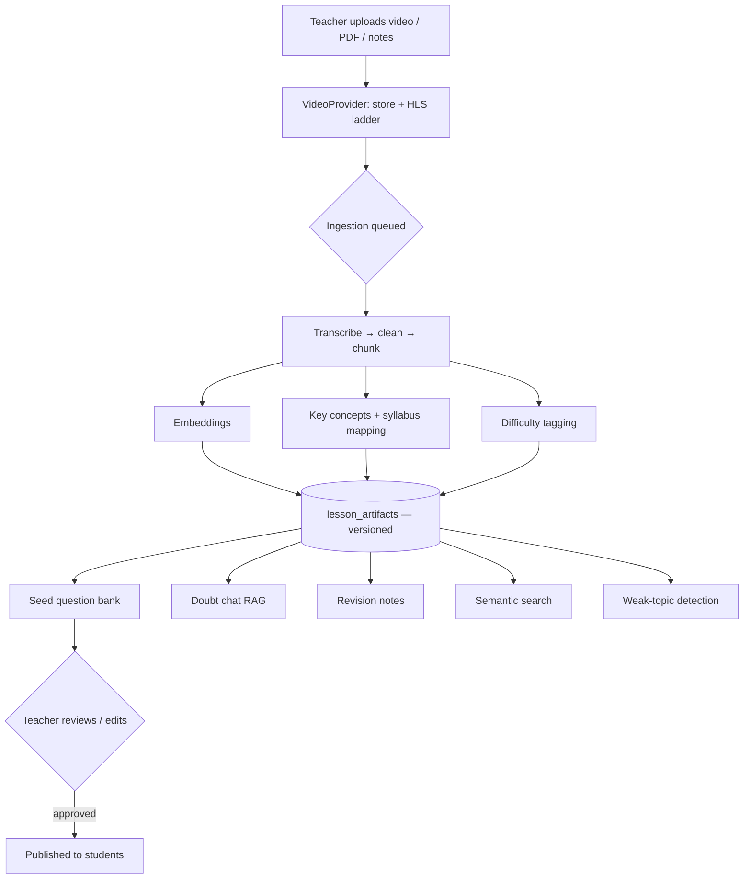
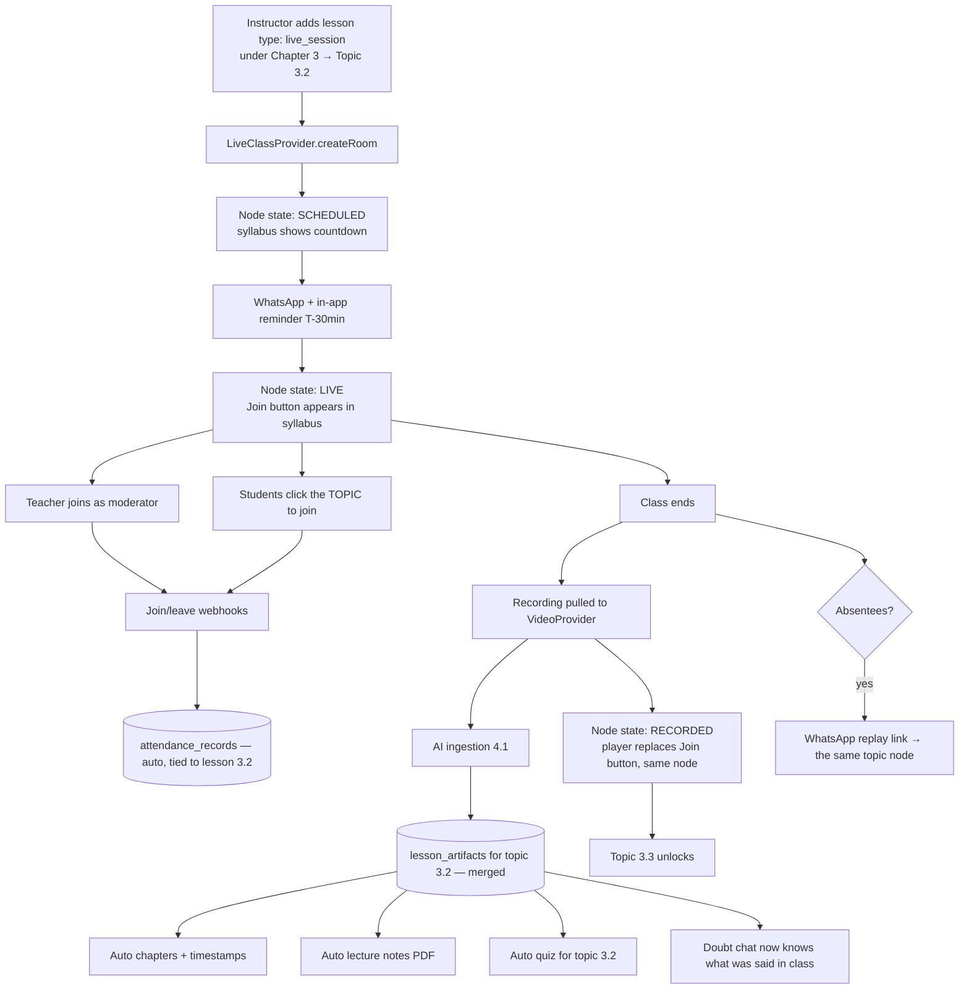
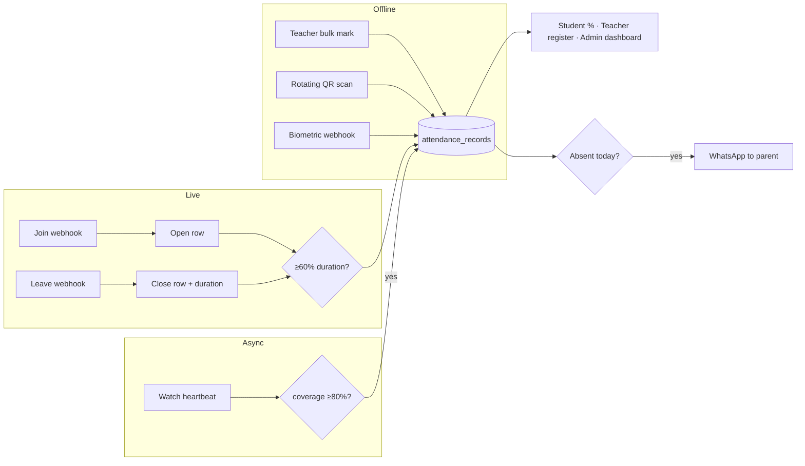
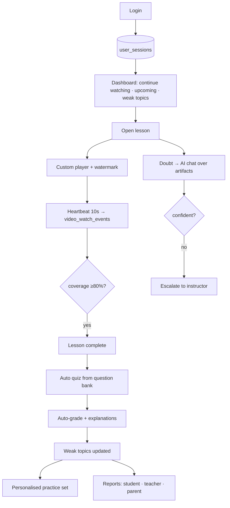
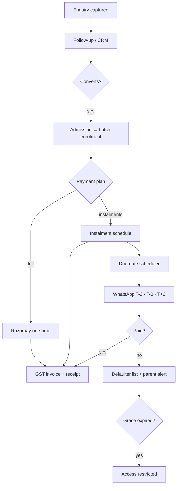
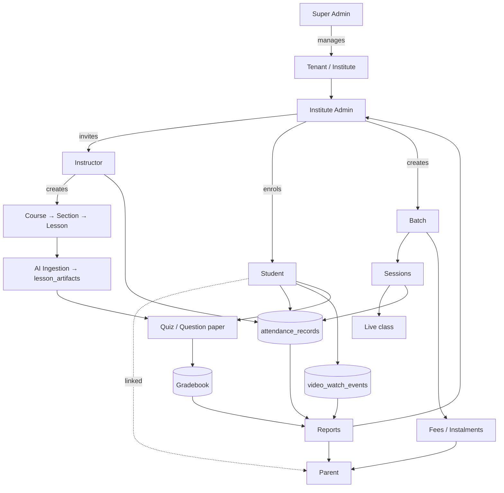

# Feature Specification — AI-Based LMS for Coaching Institutes

**Status:** APPROVED · 2026-08-08
**Companion doc:** [`DESIGN.md`](./DESIGN.md) — market analysis, architecture, cost model
**Next round:** tech stack selection, judged against this frozen list

## Context

An AI-native LMS for Indian coaching institutes — personal project **and** a
commercial product sold to multiple institutes. Deliberate sequencing:
**features and flows locked first, tech stack second.**

Four specific problems drove this round (video cost, Zoom licences, attendance,
progress reporting), plus a complete feature list drawn from every source on
the drive.

**All source folders have now been scanned.** The most important find: an
unread 1,119-line EARS-format requirements document with **64 numbered
requirements** — far more complete than the `skills.md` spec used until now.

### Sources scanned

| Source | Location | What it contributed |
|---|---|---|
| **`requirements.md`** | `LMS/Fresh LMS/.kiro/specs/digital-course-ai-lms/` | **64 requirements**, 35 named subsystems, 5 phases — the backbone of this list |
| `design.md` / `tasks.md` | same folder | 1,166 + 547 lines — architecture and the 170-task breakdown |
| `skills.md` | `LMS/Fresh LMS/` | Original build spec (superseded by requirements.md) |
| **Frappe LMS** | `LMS/lms` | **69 doctypes** — a complete production data model (AGPL: features studied, no code copied) |
| **Infix addon bundle** | `INFIX LMS/…universal-plugins-bundle/` | **33 paid addons** — the strongest validated-demand signal available |
| Rocket LMS, Rise CRM | `Production/` | Commercial script feature sets |
| `LMS/CRM` | NestJS + Prisma | Separate CRM experiment |
| `marshal-lms-main` | Next.js LMS | Tutorial codebase |
| `Indicator/` | Pine Script | Unrelated (trading) — excluded |
| Market research | Web, 2026 | Classplus/Teachmint pricing, WhatsApp engagement data, video/live-class costs |

**Legend for source tags below:** `[REQ-n]` = requirements.md requirement n ·
`[FRP]` = Frappe LMS doctype · `[INF]` = Infix paid addon · `[MKT]` = market
research · `[NEW]` = added by this analysis

---

## Part 1 — Master feature list

### 0. Roles & multi-tenancy — the access matrix

Five roles across an isolated multi-tenant platform. Every table below inherits
this model.

| Role | Scope | Owns |
|---|---|---|
| **Super Admin** | Whole platform | Tenants, plans, platform billing, impersonation, global audit, queue health |
| **Institute Admin** | One tenant | Branding, staff, batches, fees, reports, integrations, tenant settings |
| **Instructor** | Assigned courses/batches | Content, live classes, question bank, grading, attendance marking, their students' progress |
| **Student** | Own enrolments | Lessons, live classes, quizzes, assignments, doubts, own progress |
| **Parent** *(new)* | Linked student(s) | Attendance, marks, fee status, report cards — read-only |

**Multi-tenancy model**

```
Platform (Super Admin)
   │
   ├── Tenant A  ── institute-a.domain.com  ── own branding, own data
   ├── Tenant B  ── learn.schoolb.edu       ── custom domain + SSL
   └── Tenant C  ── suspended               ── all access blocked
```

- Every tenant-aware row carries `tenant_id`; a global scope makes cross-tenant
  reads impossible by default (A3)
- **An automated cross-tenant isolation suite is a CI release gate** — it tries
  to breach every model, route, and panel and fails the build on any leak
- Role hierarchy is enforced downward only: nobody may assign a role at or above
  their own (B7)
- Super Admin impersonation is time-boxed (60 min) and fully audited (A6)
- Multi-branch institutes get an organisation layer above batches (A9)

### A. Platform & Multi-Tenancy

| # | Feature | Source | Phase |
|---|---|---|---|
| A1 | Tenant provisioning, subdomain routing, custom domain + SSL | REQ-1 | P1 |
| A2 | Central database: tenants, plans, subscriptions | REQ-1 | P1 |
| A3 | Complete data isolation via global scopes + **automated cross-tenant test suite as CI gate** | REQ-1, NEW | P1 |
| A4 | Tenant suspend/resume, session invalidation on suspend | REQ-1, REQ-5 | P1 |
| A5 | Super Admin panel: tenant + plan CRUD, paginated tenant list | REQ-5 | P1 |
| A6 | Super Admin impersonation with full audit logging, 60-min auto-expiry | REQ-4, REQ-5 | P1 |
| A7 | White-label branding: logo, favicon, primary/accent colours, branded emails | REQ-6 | P1 |
| A8 | Provisioning failure handling + retry | REQ-1 | P1 |
| A9 | **Multi-branch / organisation hierarchy** (institutes with 2–5 centres) | INF, MKT | P3 |
| A10 | Custom sidebar / navigation per tenant | FRP | P3 |

### B. Auth, Roles & Security

| # | Feature | Source | Phase |
|---|---|---|---|
| B1 | Register, login, email verification, password reset | REQ-2 | P1 |
| B2 | Google OAuth 2.0 | REQ-2 | P1 |
| B3 | Rate limiting + account lockout (5 attempts / 1 min → 15 min lock) | REQ-2 | P1 |
| B4 | "Remember me" persistent tokens (30 days) | REQ-2 | P1 |
| B5 | TOTP 2FA mandatory for Super Admin + Institute Admin, 8 backup codes | REQ-3 | P1 |
| B6 | 4-tier role hierarchy + granular permissions | REQ-4 | P1 |
| B7 | Privilege-escalation prevention | REQ-4 | P1 |
| B8 | **Parent/Guardian as a 5th role** | NEW, MKT | P1 |
| B9 | Device fingerprinting + registered-device limit (default 2) | REQ-33 | P2 |
| B10 | Concurrent session limit + remote device logout | REQ-33 | P2 |
| B11 | Login history, geolocation, impossible-travel detection | REQ-34 | P2 |
| B12 | Account-sharing detection + forced re-auth | REQ-36 | P2 |
| B13 | Immutable append-only audit log, 365-day retention | REQ-35 | P2 |
| B14 | CSRF, XSS sanitisation, mass-assignment guards, file-type allowlist | REQ-28 | P1 |
| B15 | GDPR / India DPDP: consent, data export, deletion, cookie consent | REQ-37 | P2 |

### C. Course & Content Structure

| # | Feature | Source | Phase |
|---|---|---|---|
| C1 | Course CRUD — draft/published/archived, thumbnail, pricing | REQ-7 | P1 |
| C2 | Hierarchy: Course → Section (max 50) → Lesson (max 50) | REQ-7, FRP | P1 |
| C3 | Lesson types: video, PDF, audio, text/markdown, embed, quiz | REQ-7 | P1 |
| C4 | Drip content scheduling | REQ-7 | P1 |
| C5 | Free-preview lessons | REQ-7 | P1 |
| C6 | Drag-and-drop reordering | REQ-7 | P1 |
| C7 | Categories, subcategories, tags; catalog filtering | REQ-48, FRP | P2 |
| C8 | Course prerequisites + sequential lesson unlocking + circular-dependency check | REQ-49 | P2 |
| C9 | **Programs** — multi-course bundles | FRP | P2 |
| C10 | Course catalog, search, wishlist, recommendations | REQ-41 | P2 |
| C11 | Course mentor mapping | FRP | P3 |
| C12 | **Programming exercises with test cases** (auto-evaluated code) | FRP | P3 |
| C13 | SCORM import | INF | P3 |

### D. Video Delivery & Protection

| # | Feature | Source | Phase |
|---|---|---|---|
| D1 | **`VideoProvider` interface** — Bunny / Vimeo / YouTube-unlisted / S3-compat swappable | NEW | P1 |
| D2 | Custom HLS player: play/pause, ±10 s, seek, **volume defaults to 70%**, speed 0.5×–2×, quality, captions | REQ-8 | P1 |
| D3 | Adaptive bitrate; **480p default, 720p opt-in** (≈3× bandwidth saving) | REQ-8, NEW | P1 |
| D4 | Dynamic visible watermark — name + email + ID, repositions every 30 s, persists in fullscreen | REQ-8 | P1 |
| D5 | Right-click disabled, download hidden, save blocked | REQ-8 | P1 |
| D6 | Signed playback tokens, 5-min TTL, scoped to student + course | REQ-8, REQ-32 | P1 |
| D7 | Resume from last position, cross-device | REQ-8 | P1 |
| D8 | **Per-tenant bandwidth metering + plan quota + overage billing** | NEW | P1 |
| D9 | Concurrent-playback limiting (anti account-sharing) | REQ-8, REQ-33 | P2 |
| D10 | Multi-DRM: Widevine / FairPlay / PlayReady | REQ-32 | P3 |
| D11 | Invisible forensic watermark (traces leaks to a student) | REQ-8 | P3 |
| D12 | Offline DRM licence for PWA downloads, ≤30-day expiry | REQ-32 | P3 |
| D13 | Auto-subtitles from ingestion transcript (SRT/VTT), instructor-editable | REQ-22 | P2 |

### E. Document Protection

| # | Feature | Source | Phase |
|---|---|---|---|
| E1 | In-app secure PDF/document viewer, no direct download unless enabled | REQ-50 | P1 |
| E2 | **Per-student watermark on every rendered page** | REQ-50 | P1 |
| E3 | Signed access URLs (5-min TTL) + enrolment verification | REQ-50 | P1 |
| E4 | Print/save disable per lesson | REQ-50 | P2 |

### F. Batches & Enrolment

| # | Feature | Source | Phase |
|---|---|---|---|
| F1 | Batch CRUD: dates, seat limit, price, paid/free, self-enrol flag | REQ-9, FRP | P1 |
| F2 | Three enrolment modes: manual add, self-enrol with approval, direct self-enrol | REQ-9 | P1 |
| F3 | Waitlist (FIFO) + auto-promotion on seat release | REQ-9 | P1 |
| F4 | Approval expiry (7 days) with notification | REQ-9 | P1 |
| F5 | Session scheduling (15–480 min) | REQ-9 | P1 |
| F6 | Batch-scoped discussion forum (3-level nesting) | REQ-9 | P2 |
| F7 | **Timetable templates + teacher conflict detection** | FRP, NEW | P2 |
| F8 | Batch feedback collection | FRP | P2 |
| F9 | Bulk student CSV import (≤5000 rows) with per-row error report | REQ-47 | P2 |
| F10 | Bulk enrolment + bulk invitations as background jobs | REQ-47 | P2 |

### G. Live Classes

> **Owner's idea — topic-anchored live classes.** This changes the content
> model, so it is specified before the feature table.

**The problem with how every LMS does this today.** Live classes live in a
calendar, recorded lessons live in the course tree. Two parallel structures. A
student who missed Thursday's class has to know it was Thursday, find it in a
sessions list, and hunt for the recording — which lands in a "recordings" folder
disconnected from the syllabus.

**The owner's model:** a live class **is a node in the course tree**. The
student browses the syllabus, sees the topic, and joins from there. Afterwards
the recording lands back in that same node automatically.

```
Course: Physics — Class 12
└── Chapter 3: Thermodynamics
    ├── 3.1 First Law                 [video]      ✓ watched
    ├── 3.2 Entropy                   [LIVE 6:00pm] ← click here to join
    ├── 3.3 Carnot Cycle              [scheduled]   🔒 unlocks after 3.2
    └── 3.4 Practice Set              [quiz]
```

**One node, three states — the lesson never moves:**

```
  SCHEDULED ──────► LIVE ──────► RECORDED
      │               │              │
  "Starts 6:00pm"  "Join now"   Player + transcript
  reminder sent    attendance   + AI quiz + notes
                   auto-tracked   auto-attached
```

**Why this is materially better, not just nicer:**

| Benefit | Mechanism |
|---|---|
| **Absentee recovery is automatic** | The recording appears exactly where the student would look for the topic — no hunting |
| **AI grounding gets richer** | The recording is ingested and merged into *that topic's* `lesson_artifacts`, so the doubt chat for Thermodynamics knows what the teacher actually said in class |
| **Attendance attaches to content, not just a calendar** | "Present for 3.2" is more useful than "present on Thursday" |
| **Sequential unlocking works across live and recorded alike** | 3.3 can require 3.2 regardless of whether 3.2 was live or pre-recorded |
| **Syllabus progress becomes real** | Live classes count toward chapter completion automatically |
| **Zero manual filing** | The teacher never uploads or files a recording |

**Implementation shape:** `live_session` becomes a first-class lesson type
alongside video/PDF/text. The lesson row carries `scheduled_at`,
`live_provider`, `room_id`, and `recording_asset_id`. State is derived from
those plus wall-clock time, so the same node renders a countdown, then a Join
button, then a player — without the teacher touching anything.

| # | Feature | Source | Phase |
|---|---|---|---|
| **G0** | **Topic-anchored live class — `live_session` lesson type, one node with scheduled → live → recorded states** | **OWNER** | **P1** |
| G0a | Auto-attach recording back to the originating lesson node | OWNER | P1 |
| G0b | Recording auto-ingested and merged into that topic's `lesson_artifacts` | OWNER, NEW | P1 |
| G0c | Join from the syllabus tree; countdown before start | OWNER | P1 |
| G0d | Live class counts toward chapter/syllabus completion | OWNER, NEW | P1 |
| G1 | **`LiveClassProvider` interface** — BBB / Jitsi / Zoom Video SDK / external link | NEW | P1 |
| G2 | **BigBlueButton self-hosted as default** — zero licences, zero per-minute | NEW, INF | P1 |
| G3 | Auto-create room on session scheduling; role-scoped join links | REQ-10 | P1 |
| G4 | **External meeting-link provider** — paste any URL, zero setup, day-one path | NEW | P1 |
| G5 | Recording capture → storage → **fed into AI ingestion** | REQ-10, NEW | P2 |
| G6 | Recordings via short-lived signed URLs + enrolment check | REQ-10 | P2 |
| G7 | Zoom OAuth per institute (for institutes that require Zoom) | REQ-10 | P2 |
| G8 | Google Meet provider | INF, FRP | P2 |
| G9 | **Live polls / quick quizzes during class**, real-time aggregation | REQ-54 | P2 |
| G10 | Webhook signature verification; token-expiry handling | REQ-10 | P2 |

### H. Attendance ← *raised as a gap; largely missing from requirements.md*

| # | Feature | Source | Phase |
|---|---|---|---|
| H1 | **One `attendance_records` table, three writers** (manual/QR · live webhook · video coverage) | NEW | P1 |
| H2 | Teacher bulk marking — default all-present, tap absentees | REQ-9, NEW | P1 |
| H3 | **Rotating session QR** (regenerates every 30 s to stop photo-sharing) | NEW | P1 |
| H4 | **Auto-attendance from live-class join/leave webhooks**, ≥60% duration = present | REQ-10, NEW | P1 |
| H5 | Rejoin merging — dropped connections don't cost attendance | NEW | P1 |
| H6 | **Async attendance = video coverage ≥80%** (seek-skips excluded) | NEW | P1 |
| H7 | **Teacher attendance** — same table, `role=teacher`; feeds payouts | NEW | P1 |
| H8 | Student/teacher/admin attendance dashboards + registers + export | NEW | P1 |
| H9 | **Absence → same-day WhatsApp to parent** (most-requested in this market) | MKT, NEW | P1 |
| H10 | Low-attendance threshold alerts | NEW | P2 |
| H11 | Geofenced check-in | NEW | P3 |
| H12 | Biometric / RFID device webhook | NEW | P3 |
| H13 | Substitute-teacher workflow on unmarked teacher absence | NEW | P3 |

### I. Assessments

| # | Feature | Source | Phase |
|---|---|---|---|
| I1 | MCQ, true/false, short answer; per-course question bank | REQ-12 | P1 |
| I2 | Randomised selection; no two consecutive identical sets | REQ-12 | P1 |
| I3 | Time limits (1–180 min), attempt limits (1–10), auto-submit on expiry | REQ-12 | P1 |
| I4 | Auto-grading within 5 s; explanations shown with results | REQ-12 | P1 |
| I5 | Short answers → pending instructor review + partial score | REQ-12 | P1 |
| I6 | **Extended types:** multi-select, fill-in-the-blank, matching pairs, ordering, with partial credit | REQ-52 | P2 |
| I7 | **Numerical questions** (JEE/NEET style) | NEW, MKT | P1 |
| I8 | Proctoring: tab-switch detection, fullscreen enforcement, copy-paste block, per-question timing | REQ-15 | P3 |
| I9 | Violation threshold → auto-submit + flag for review | REQ-15 | P3 |
| I10 | **Test series with All-India Rank, percentile, topper comparison** | NEW, MKT | P2 |
| I11 | **OMR sheet scanning for offline tests → auto-grade** | NEW, MKT | P3 |

### J. Assignments & Gradebook

| # | Feature | Source | Phase |
|---|---|---|---|
| J1 | Assignment CRUD: due date, max marks, file types, size limits | REQ-13, FRP | P2 |
| J2 | Up to 5 files per submission; late flag with lateness recorded | REQ-13 | P2 |
| J3 | Grading: marks, written feedback, rubric scoring | REQ-13 | P2 |
| J4 | Resubmission (≤3 versions) with full version history | REQ-13 | P2 |
| J5 | **Consolidated gradebook** — weighted scheme summing to 100% | REQ-51 | P2 |
| J6 | At-risk student flagging below threshold | REQ-51 | P2 |
| J7 | Gradebook export: CSV / Excel / PDF | REQ-51 | P2 |
| J8 | Course evaluators + evaluator scheduling | FRP | P3 |

### K. Certificates

| # | Feature | Source | Phase |
|---|---|---|---|
| K1 | Auto-generate PDF on completion + passing threshold | REQ-14, FRP | P2 |
| K2 | Tenant branding in template; per-institute customisation (layout, signature, background) | REQ-14 | P2 |
| K3 | Unique verification ID + QR → public verification page | REQ-14 | P2 |
| K4 | LinkedIn-shareable link with metadata | REQ-14 | P2 |
| K5 | Certificate request + evaluation workflow | FRP | P3 |

### L. AI Layer ← *restructured: ingestion spine, not four bolt-ons*

| # | Feature | Source | Phase |
|---|---|---|---|
| L1 | **Ingestion pipeline** — transcript → chunk → embeddings → concepts → syllabus map → difficulty tags → seed question bank | NEW | P1 |
| L2 | **`lesson_artifacts` versioned store** — old quizzes stay pinned to the version they came from | NEW | P1 |
| L3 | Idempotent, resumable, queue-backed; survives provider outage | NEW | P1 |
| L4 | **Per-tenant AI spend metering, enforced pre-request** | NEW | P1 |
| L5 | **AI question paper generation** — blueprint-driven, from teacher's own notes | REQ-19, MKT | P1 |
| L6 | **Teacher review/edit/approve gate — nothing auto-publishes to students** | REQ-19, NEW | P1 |
| L7 | **Doubt-solving chat (RAG)** — Hinglish + English, scoped to course, escalates to instructor | REQ-21 | P1 |
| L8 | Chat rate limiting (60 q/student/hour/course) | REQ-21 | P1 |
| L9 | AI course outline generation from a topic prompt | REQ-20 | P2 |
| L10 | Auto-subtitles (Whisper-class transcription) | REQ-22 | P2 |
| L11 | Revision notes / lesson summaries from artifacts | NEW | P2 |
| L12 | Semantic search across course content | REQ-29, NEW | P2 |
| L13 | **Weak-topic detection** — quiz results × concept map | NEW | P2 |
| L14 | **Photo-based doubt solving** — student photographs a handwritten question → step-by-step solution | NEW, MKT | P2 |
| L15 | AI content generation assist for instructors | INF | P3 |

### M. Progress & Analytics ← *raised as a gap; requirements.md only covers basics*

| # | Feature | Source | Phase |
|---|---|---|---|
| M1 | **Watch heartbeat every 10 s storing position ranges** (not a counter) | NEW | P1 |
| M2 | **Watch hours** from unique watched ranges | NEW | P1 |
| M3 | **Coverage %** — unique seconds ÷ duration; skipping cannot fake it | NEW | P1 |
| M4 | **Login count, active days, streak, time-on-platform** (`user_sessions`) | NEW | P1 |
| M5 | **Engagement ratio** — watch time ÷ wall-clock (detects background tabs) | NEW | P2 |
| M6 | Speed profile (sustained 2× ⇒ disengaged) | NEW | P2 |
| M7 | **Rewatch heatmap** — which 90 seconds the whole batch replays | NEW | P2 |
| M8 | Drop-off point per lesson | NEW | P2 |
| M9 | Quiz performance trend over attempts | REQ-44 | P1 |
| M10 | Student progress report + PDF download | REQ-44 | P1 |
| M11 | Instructor batch table sortable by coverage/score/attendance; at-risk list | REQ-11, NEW | P1 |
| M12 | Institute-admin dashboards: revenue, enrolments, course performance, instructor activity | REQ-11 | P1 |
| M13 | Student dashboard: progress, continue-watching (5), upcoming 7 days, certificates | REQ-11 | P1 |
| M14 | **Monthly parent report card (PDF) delivered on WhatsApp** | NEW, MKT | P2 |
| M15 | Automated nudges: 3-day inactivity, missed class replay, weak-topic practice | NEW | P2 |
| M16 | Cached aggregations refreshed ≤60 s | REQ-11, REQ-44 | P1 |

### N. Communication & Engagement

| # | Feature | Source | Phase |
|---|---|---|---|
| N1 | **WhatsApp as primary channel** (BSP: AiSensy/Interakt) — reminders, absences, fee dues, replays | REQ-26, MKT, NEW | P1 |
| N2 | Transactional email | REQ-26 | P1 |
| N3 | In-app notification centre, mark read / mark all read, per-category preferences | REQ-26 | P1 |
| N4 | Session reminders (T-30 min), assignment due reminders (T-24 h) | REQ-26 | P1 |
| N5 | Queued delivery, idempotency, 3-retry policy | REQ-26 | P1 |
| N6 | Course/batch announcements | REQ-43, FRP | P1 |
| N7 | **Lesson-level Q&A** with upvoting and resolved marking | REQ-39 | P2 |
| N8 | **Timestamped notes + bookmarks** on video | REQ-38, FRP | P2 |
| N9 | Direct messaging (1:1, tenant-scoped, block/report) | REQ-53 | P2 |
| N10 | Course ratings + reviews with instructor response + moderation | REQ-40, FRP | P2 |
| N11 | Real-time delivery via WebSockets, private channels, reconnect with catch-up | REQ-25 | P2 |
| N12 | **Study planner + calendar + iCal export** | REQ-42 | P2 |
| N13 | Google Calendar sync | INF | P3 |
| N14 | General forum (beyond batch discussion) | INF | P3 |
| N15 | Feedback surveys / custom forms with aggregation + CSV export | REQ-55, INF | P2 |
| N16 | Help desk / support tickets with SLA tracking | REQ-57, INF | P2 |
| N17 | **1-on-1 doubt appointment booking** | INF | P3 |
| N18 | Gamification: XP, badges, streaks, levels, leaderboards | REQ-23, FRP | P3 |

### O. Parent / Guardian ← *completely absent from requirements.md*

| # | Feature | Source | Phase |
|---|---|---|---|
| O1 | **Parent role + linkage to one or more students** | NEW, MKT | P1 |
| O2 | Parent portal: attendance, marks, fee status, progress | NEW, MKT | P1 |
| O3 | **Same-day WhatsApp on absence** | NEW, MKT | P1 |
| O4 | Fee-due and overdue WhatsApp reminders | NEW, MKT | P1 |
| O5 | Monthly report card on WhatsApp | NEW, MKT | P2 |
| O6 | Parent–teacher message thread | NEW | P3 |

### P. Payments & Fees

| # | Feature | Source | Phase |
|---|---|---|---|
| P1 | Razorpay order creation, webhook signature verification, idempotency keys | REQ-16 | P1 |
| P2 | Coupon codes — percentage or fixed, usage limits | REQ-16, FRP | P1 |
| P3 | **Instalment plans with schedule, due dates, tracking** | REQ-16, INF, MKT | P1 |
| P4 | **GST-compliant invoices + receipts** | REQ-17, INF | P1 |
| P5 | Auto-enrolment on payment; retry on failure | REQ-16 | P1 |
| P6 | Refunds within institute-configured window | REQ-16 | P2 |
| P7 | **Fee defaulter list + automated WhatsApp reminders (T-3 / T-0 / T+3)** | MKT, NEW | P1 |
| P8 | **Grace period → access restriction on non-payment** | NEW | P2 |
| P9 | Student subscription / membership plans with trials, proration | REQ-61, INF | P3 |
| P10 | Pluggable gateway layer + multi-currency + regional tax rules | REQ-62, INF | P3 |

### Q. B2B Billing (platform → institute)

| # | Feature | Source | Phase |
|---|---|---|---|
| Q1 | Plan tiers with seat, storage, **and bandwidth** limits | REQ-17, NEW | P2 |
| Q2 | Seat/storage/bandwidth enforcement at the point of action | REQ-17, NEW | P2 |
| Q3 | Razorpay recurring subscriptions for institutes | REQ-17 | P2 |
| Q4 | 7-day grace period → suspension | REQ-17 | P2 |
| Q5 | Plan upgrade/downgrade with proration | REQ-17 | P2 |
| Q6 | MRR / ARR, per-institute revenue, success/failure rates | REQ-18 | P3 |
| Q7 | Revenue export CSV/PDF as background job | REQ-18 | P3 |

### R. Growth & Monetisation Extensions

| # | Feature | Source | Phase |
|---|---|---|---|
| R1 | Affiliate / referral codes, commission rules, reversal on refund | REQ-63, INF | P3 |
| R2 | Affiliate dashboard + payout requests | REQ-63 | P3 |
| R3 | Instructor payouts: salaried or revenue-share, approval workflow | REQ-64, INF | P3 |
| R4 | Cashback, gift, registration bonus | INF | P3 |
| R5 | **Store for physical study material** | INF, MKT | P3 |
| R6 | Upcoming-course announcements / pre-launch interest capture | INF, FRP | P3 |

### S. Institute Operations

| # | Feature | Source | Phase |
|---|---|---|---|
| S1 | Instructor invitations (14-day link), assignment to courses/batches, deactivate/reactivate | REQ-46 | P1 |
| S2 | Per-instructor permission sets | REQ-46 | P2 |
| S3 | Reports: enrolment, attendance, gradebook, revenue, engagement, completion — CSV/Excel/PDF as jobs | REQ-56 | P2 |
| S4 | **Enquiry → follow-up → admission CRM** | MKT, NEW | P2 |
| S5 | **ID card generation** | NEW, MKT | P3 |
| S6 | Noticeboard | INF | P2 |
| S7 | **Job board / placement module** (education detail, industry, function) | FRP | P3 |

### T. Integrations, API & Platform Quality

| # | Feature | Source | Phase |
|---|---|---|---|
| T1 | Versioned REST API `/api/v1/`, consistent error envelope, rate limits, pagination | REQ-27 | P1 |
| T2 | Background job queues by priority, retry with backoff, failed-job retention | REQ-31 | P1 |
| T3 | Daily encrypted backups, 30-day retention, **rehearsed restore** | REQ-28, NEW | P1 |
| T4 | Full-text search across courses, lessons, users | REQ-29 | P2 |
| T5 | Institute API keys + **outbound webhooks** (HMAC-signed, 5 retries, delivery log) | REQ-58 | P3 |
| T6 | i18n: per-user/tenant language, locale formatting, RTL, translated emails | REQ-59 | P3 |
| T7 | Accessibility WCAG 2.1 AA: keyboard nav, ARIA, contrast, focus, alt text, captions | REQ-60 | P2 |
| T8 | PWA: installable, push, offline downloads (≤50 lessons), offline indicator | REQ-24 | P3 |
| T9 | User profile: avatar, bio, timezone, language, notification prefs, password change, visibility | REQ-45 | P1 |

### U. Additional features worth adding

Beyond everything above. These come from the AI spine already existing (so they
are cheap to add), from Indian coaching reality, or from the topic-anchored
model in Section G.

**U-a. Free because the ingestion spine already exists**

| # | Feature | Why it is nearly free | Phase |
|---|---|---|---|
| U1 | **Auto lecture notes from a live class** — transcript → structured PDF notes, posted to the topic within minutes of class ending | Transcript is already produced by L1 | P1 |
| U2 | **Auto chapters / timestamps on recordings** — jump straight to "Carnot cycle explanation at 34:12" | Concepts + timings already extracted | P1 |
| U3 | **Daily Practice Problems (DPP)** — an auto-generated daily set from topics taught so far | Question bank already seeded per topic | P1 |
| U4 | **Ask-at-timestamp** — student pauses at 12:30 and asks; AI answers using *that* part of the lesson | Chunks are already time-anchored | P2 |
| U5 | **Auto formula sheet / revision cards** per chapter | Key concepts already extracted | P2 |
| U6 | **Auto quiz right after every live class** | Recording ingestion already runs | P1 |
| U7 | **Audio-only revision mode** — strips video, plays narration | **Also cuts bandwidth ~10×**, tying directly into the cost problem in Part 3.1 | P2 |
| U8 | **Teacher lesson-plan assistant** — AI drafts a plan for the next topic from the syllabus map | Syllabus mapping already exists | P2 |

**U-b. The one nobody else has**

| # | Feature | What it does | Phase |
|---|---|---|---|
| U9 | **Confusion signal** | Combines rewatch heatmap (M7) + doubt-chat volume per topic + quiz failure rate into one ranked list: *"Your batch is stuck on Entropy — 34 doubts, 12 rewatches of 08:40–10:10, 61% failed Q4."* Tells the teacher exactly what to re-teach, before the test says so. | P2 |

**U-c. Indian coaching essentials**

| # | Feature | Why | Phase |
|---|---|---|---|
| U10 | **Syllabus tracker** — institute maps lessons to the board/exam syllabus; shows "Physics 62% complete, on track for March" | The number parents and admins actually ask for | P1 |
| U11 | **PYQ bank** — previous-year questions tagged to topics | JEE/NEET/UPSC preparation runs on PYQs | P2 |
| U12 | **Scholarship test module** | The standard student-acquisition channel for Indian institutes | P2 |
| U13 | **Free demo class** access for prospects, with conversion tracking | Top of the admission funnel | P2 |
| U14 | **Hall ticket / admit card generation** | Every offline test needs one | P3 |
| U15 | **Rank card PDF** — score, rank, percentile, subject breakdown | Pairs with test series (I10) | P2 |
| U16 | **Backlog / catch-up mode** — student behind schedule gets an auto-generated catch-up plan | Retention lever; drop-off usually starts with falling behind | P2 |
| U17 | **Dual-language content tracks** — same course in Hindi and English | Large segment of the market teaches in Hindi | P3 |
| U18 | **Attendance-linked access rules** (optional per institute) | Some institutes tie content access to attendance | P3 |

**U-d. WhatsApp-native (the channel that actually works)**

| # | Feature | Why | Phase |
|---|---|---|---|
| U19 | **WhatsApp doubt bot** — student sends a doubt on WhatsApp, AI answers there, grounded in their enrolled course | 90% engagement vs 25–30% email; students already live there | P2 |
| U20 | **Voice-note doubts in Hinglish** — student speaks, transcription + AI answers | Typing physics is painful; speaking is not | P2 |
| U21 | **Photo doubt over WhatsApp** — extends L14 to the channel students already use | Removes the "open the app" step entirely | P2 |

**U-e. Operational**

| # | Feature | Why | Phase |
|---|---|---|---|
| U22 | **Conflict-free timetable auto-scheduler** — respects teacher availability, room limits, batch clashes | Manual timetabling is a weekly admin chore | P3 |
| U23 | **Fee analytics** — collection rate, projected revenue, defaulter ageing | The institute owner's primary dashboard | P2 |
| U24 | **Peer comparison** — "you're in the top 20% of your batch on Thermodynamics" | Motivation without a public leaderboard's downside | P2 |
| U25 | **Print-friendly notes export** | Indian students still print and annotate | P3 |

---

## Part 2 — Gap analysis: what `requirements.md` misses

The existing 64-requirement spec is strong on platform, security, and content.
These are the material gaps this analysis adds:

| Gap | Why it matters |
|---|---|
| **No parent role at all** | Parents pay the fees in this market. Classplus and Teachmint both ship parent access. Section O is entirely new. |
| **WhatsApp is optional** (REQ-26.6 "WHERE enabled") | 90%+ engagement vs 25–30% email; attendance 47%→71% with WhatsApp reminders. It is the channel, not a toggle. |
| **Attendance is thin** — only manual marking (REQ-9.8) and Zoom-derived (REQ-10.10) | No offline QR, no biometric, no async/video-based, no teacher attendance. Section H rebuilds it. |
| **Progress analytics are shallow** (REQ-44) | Completion % and time-spent only. No watch heartbeat, coverage, engagement ratio, or rewatch heatmap. |
| **AI is four bolt-ons** (REQ-19/20/21/22) | Each re-derives understanding separately. Restructured into one ingestion spine (Section L). |
| **Instalments ride on Razorpay EMI** (REQ-16.5) | Indian coaching runs on institute-defined instalment schedules, not card EMI. Infix sells this as a separate paid addon. |
| **Zoom-only live classes** | Causes the per-host licence problem. Section G makes it provider-agnostic with a zero-licence default. |
| **Mux + AWS S3 storage assumption** (REQ-30) | Costed against Bunny; see Part 3.1. |
| **No test series / rank** | JEE/NEET/UPSC coaching runs on All-India Rank and percentile, not raw marks. |
| **No OMR scanning** | Offline tests remain the norm in most institutes. |
| **No enquiry/admission CRM** | The top of the funnel every institute actually operates. |
| **No bandwidth in plan limits** (REQ-17 has seats + storage) | Video bandwidth is the largest variable cost; it must be a metered, billable plan dimension. |

---

## Part 3 — The four raised problems

### 3.1 Video: the premise is inverted — Vimeo is the expensive option

| Option | Cost | DRM | Verdict |
|---|---|---|---|
| **Bunny Stream** | $0.005/GB storage + **$0.03/GB delivery (Asia)**, transcoding free | Token auth, signed URLs, DRM available | **Cheapest at every tier tested** |
| Vimeo Scale | **$165/mo** ≈ 2 TB/mo | **DRM is Enterprise-only** | Hard caps |
| Vimeo Enterprise | **$6,000+/yr**, auto-triggered on exceeding caps | Yes | A cliff, not a plan |
| YouTube unlisted | **Free** | None — leakable | Cheap tier only |

At 200 students × 10 hrs/mo (~1.4 TB): **Bunny ≈ $42/mo vs Vimeo $165/mo.**
Bunny only reaches $165 at ~5.5 TB, by which point Vimeo would have forced an
Enterprise contract. **Moving to Vimeo makes the bill ~4× worse and removes DRM.**

**Fix the cost driver, not the vendor** — D1, D3, D8 above: 480p default
(≈3× saving), adaptive bitrate, per-plan resolution caps, PWA offline
(repeat views free), and per-tenant bandwidth metering that converts platform
cost into institute-billable cost.

> No DRM stops a phone camera pointed at a screen. The realistic deterrent is
> the moving personalised watermark (D4) that makes leaks traceable.

### 3.2 Live classes: eliminate licences entirely

| Option | Cost | Licences | Teaching features |
|---|---|---|---|
| **BigBlueButton (self-host)** | **Server only, flat, unlimited** | **None** | **Purpose-built**: whiteboard, breakout rooms, polls, recording |
| Jitsi (self-host) | Server only | None | General-purpose, lighter |
| **Zoom Video SDK** | **$3.50/1,000 participant-min**, 10k free/mo | **None** — usage-based | Zoom quality |
| Zoom Business accounts | ~$52,000/yr @ 200 users | **Per host** ← the problem | — |

**Key correction:** Zoom **Video SDK** is a different product from Zoom accounts
and needs **no host licences**.

At 50 students × 60 min × 20 classes/mo: Zoom Video SDK ≈ **$210/mo** vs BBB
self-hosted ≈ **₹4,000–6,000/mo flat, unlimited**. → **BBB default** (G2), with
`ExternalLinkProvider` (G4) giving a zero-setup day-one path.

### 3.3 Attendance → Section H (13 features, three writers, one table)

### 3.4 Progress reporting → Section M (16 features, heartbeat-driven)

---

## Part 4 — System flows

### 4.1 AI content ingestion



### 4.2 Topic-anchored live class — one lesson node, three states



The lesson node never moves and the teacher never files anything. A student who
missed the class opens the syllabus, finds Topic 3.2 exactly where it always
was, and gets the recording, notes, and quiz in place.

### 4.3 Attendance — three writers, one table



### 4.4 Student learning loop



### 4.5 Fees, enrolment and defaulters



### 4.6 Role and data map



---

## Part 5 — Phase totals

| Phase | Feature count | Definition |
|---|---|---|
| **P1** | ~95 | Everything needed for **Institute Zero** — one institute, one batch, real students, real fees |
| **P2** | ~75 | Depth after the first paying institute |
| **P3** | ~55 | Scale, growth, compliance, enterprise |

**~225 features total** across 21 modules (0, A–U).

**Institute Zero is done when:** institute onboarded and branded · ≥1 course with
≥10 ingested lessons · ≥1 batch with ≥10 real students · fees collected including
one instalment plan · students watched video and attempted an **AI-generated**
quiz · ≥50 doubt-chat questions answered · WhatsApp reminders firing on a real
schedule · attendance running in all three modes · **the teacher says the AI
question bank saved them measurable time.**

**Blocking engineering gates:** cross-tenant isolation suite green in CI ·
ingestion survives provider outage without data loss · per-tenant AI *and*
bandwidth spend capped and visible · video and documents unreachable without
signed URL + enrolment check.

---

## Part 6 — How to verify this spec

1. **Coverage** — every Infix addon, every Frappe doctype group, and all 64
   requirements map to a row in Part 1 or appear in Part 2 as a deliberate gap.
2. **Flow soundness** — trace three journeys end-to-end with no orphan step:
   (a) upload → AI quiz reaches student; (b) live class → absentee's parent gets
   a WhatsApp replay link; (c) enquiry → instalment → defaulter → access
   restricted.
3. **Cost sanity** — recompute video bandwidth and AI spend at 200 / 1,000 /
   5,000 students; each must stay a defensible share of revenue per student.

---

## Part 7 — Module V: Platform Hardening & Migration

Added 2026-08-08 after a line-by-line comparison against the original build specs
(`lms-build-spec.md` and `skills.md`). Those two files are near-identical;
`lms-build-spec.md` is `skills.md` plus a Strangler-Pattern migration note, a
circuit-breaker line, a vector-DB line, and an entire Phase 6.

The comparison covered roughly 130 original requirements: 108 were already
present in this document, 12 were deliberately changed (stack decisions, all
documented), and **14 were genuinely missing**. This module closes those 14.

### V-a. Resilience and correctness

| # | Feature | Why it matters | Phase |
|---|---|---|---|
| V1 | **Circuit breaker on every external provider** — after N consecutive failures the provider is tripped open for a cooldown, requests fail fast, and a half-open probe restores it | The plan already has retry with exponential backoff (T2), but retry alone makes a slow-failing provider *worse*: every request queues behind timeouts until the app stalls. Applies to Bunny, Claude, Razorpay, the WhatsApp BSP, and the live-class provider. Breaker state must be visible in the admin dashboard and alert to Sentry | P1 |
| V2 | **Explicit cache invalidation on write** — updating a course, lesson, batch, or artifact busts its cache keys immediately | Supersedes the TTL-only approach in M16 ("cached aggregations refreshed ≤60 s"). TTL-only means a teacher edits a lesson and students keep seeing the old version for up to a minute with no way to force a refresh. The original spec called this out specifically | P1 |
| V3 | **Soft deletes on recoverable entities** — `courses`, `batches`, `users`, `lessons`, `enrollments`, `payments` | A mis-click that deletes a live batch mid-term is unrecoverable without this. Restore must be exposed in the admin panel, not only at the database level. Note the interaction with tenancy: the global scope must not leak soft-deleted rows across tenants when `withTrashed()` is used | P1 |
| V4 | **Form Request validation on every endpoint** — no inline `$request->validate()` in controllers | Makes validation rules discoverable and testable in one place per action, and stops the drift that happens across ~60 resources | P1 |
| V5 | **Eloquent-only data access** — no raw SQL string concatenation anywhere | Raw SQL bypasses the `BelongsToTenant` global scope. In a single-database multi-tenant system that is not a style preference, it is the exact mechanism by which a cross-tenant leak happens. The isolation suite cannot catch a leak in raw SQL it does not know about | P1 |

### V-b. Operations and deployment

| # | Feature | Why it matters | Phase |
|---|---|---|---|
| V6 | **`SETUP.md`, kept current** — every environment variable, plus signup and configuration steps for Bunny, Razorpay, the WhatsApp BSP, Claude, the live-class provider, and Sentry | `CLAUDE.md` (E-T4) covers code conventions, not third-party setup. Six external services need accounts and keys before anything runs locally. Without this, a rebuilt machine or a second developer is a day lost | P1 |
| V7 | **Server hardening** — SSH key-only access, firewall restricted to 80/443/22, `bcrypt` cost 12 | Small, cheap, and each one is unpleasant to retrofit after real student data is on the box | P1 |
| V8 | **Read replicas** — read/write splitting once a single tenant's data justifies it | Deferred in the original spec too. Recorded so the query layer is written to tolerate a replica lag rather than assuming read-after-write | P3 |
| V9 | **Horizontal scaling path** — stateless app servers behind a load balancer | `DESIGN.md` §7 says "scale vertically first" and stops there. Sessions and cache already live in Redis, so the app is close to stateless; what is missing is the written statement that nothing may be kept on local disk | P3 |

### V-c. Commercial surface

| # | Feature | Why it matters | Phase |
|---|---|---|---|
| V10 | **Per-tenant feature flags** — a flags table checked in middleware, driving plan-based gating (for example, doubt chat and analytics only on higher tiers) | This is how the product gets sold in tiers at all. Without it, plan differences can only be expressed as hardcoded conditionals scattered through the code, which is unmaintainable and untestable. Pairs with Q1/Q2 (seat, storage, bandwidth limits) | P2 |
| V11 | **Card EMI through Razorpay** — separate from, and in addition to, institute-defined instalments (P3) | Instalment schedules set by the institute remain the primary model and are correct for this market. Card EMI is a different thing: the bank funds it, not the institute. Some parents will ask for it | P2 |
| V12 | **Mobile API path** — bearer-token auth alongside cookie sessions, and a decision on who `/api/v1/` actually serves | The switch to Livewire removed the API's only internal consumer, since Livewire does not use REST. `/api/v1/` (T1) currently sits in P1 with no caller. Either it moves to P3 alongside T5 (institute API keys and outbound webhooks), or a future mobile client is named as its audience. **Decision taken: T1 stays in P1 but scoped to webhook receivers and health endpoints only; the full public REST surface moves to P3 with T5** | P2 |
| V13 | **Organisation SSO** — Google Workspace, and SAML for larger buyers | Deferred in the original spec as well. Becomes a live requirement the first time a school group with its own identity provider evaluates the product | P3 |

### V-d. Migration from an existing system

| # | Feature | Why it matters | Phase |
|---|---|---|---|
| V14 | **Data import tooling** — students, courses, enrolments, and payment history from an existing LMS, with a dry-run mode and a per-row error report | Even in the greenfield case, institute #1 arrives with students in a spreadsheet and courses somewhere else. F9 covers CSV student import; this covers courses, enrolments, and historical payments | P2 |
| V15 | **Strangler-pattern cutover — conditional, not currently scheduled** | `lms-build-spec.md` states that an existing Frappe LMS instance "stays live and serving students" throughout the build, requiring module-by-module cutover and a dual-run period. **Working assumption: this is not the case.** The Frappe clone at `LMS/lms` is recorded as one of four abandoned attempts, not a production system. If that assumption is wrong, V15 becomes a P1 workstream of its own — data migration scripts, a dual-run window, and per-module cutover — and the eight-slice timeline extends by an estimated 3 to 4 weeks. Flagged rather than silently assumed | Conditional |

---

## Part 8 — Module W: Mobile App

Added 2026-08-08 at the owner's request. Mobile was previously only a PWA line
item (T8, P3). In this market that is under-scoped: students are mobile-first and
overwhelmingly on Android, and the leading competitor's entire pitch is a branded
app for each institute.

### Approach: a Capacitor shell over the existing Livewire student app

Three routes were considered.

| Route | What it gives | Decision |
|---|---|---|
| React Native | Fully native, best performance, largest talent pool | **No.** A separate codebase means two applications maintained by one person. That is the failure mode that ended the previous attempt, and JavaScript/TypeScript is not the builder's ground |
| Flutter | Same benefits, another new framework | **No.** Same problem, plus Dart as an entirely new language |
| **Capacitor shell** | The same Livewire app inside a native container; ships to the Play Store; native APIs available | **Chosen.** One codebase, one deploy. A fix on the web is a fix in the app |

This follows the same logic as the Livewire decision itself: the constraint is
finishability by one person, so every choice that avoids a second codebase wins
unless something load-bearing is lost.

### W-a. What the native shell provides that a browser cannot

| # | Feature | Why it matters | Phase |
|---|---|---|---|
| W1 | **Screen-recording and screenshot block** — Android `FLAG_SECURE` on the player surface | The single most effective anti-piracy measure available, stronger than the watermark. A browser cannot do this at all. Note the honest limit: it does not stop a second phone pointed at the screen | P2 |
| W2 | **Per-institute Play Store presence** — branded name, icon, splash, colours | The competitor's whole proposition. Parents trust an app listing in a way they do not trust a URL | P2 |
| W3 | **Offline downloads with encrypted local storage** — 30-day expiry, enrolment re-checked on open | Browser storage is not reliable for this. Data is expensive; students download at night and watch during the day | P2 |
| W4 | **Camera capture for photo doubts** — direct camera, not a file picker | Turns L14 (photo-based doubt solving) from a technically-present feature into one people actually use | P2 |
| W5 | **Voice-note doubts** — press and speak | Typing a physics question is painful. Speaking it is not. Pairs with U20 | P2 |
| W6 | **Push notifications** — class starting, quiz published, doubt answered | WhatsApp stays the primary channel; push covers in-app moments WhatsApp should not spam | P2 |
| W7 | **Background audio playback** — screen off, lecture audio continues | Revision use case, and it collapses bandwidth for repeat listening. Pairs with U7 | P3 |
| W8 | **Biometric app lock** | Shared family phones are common; a student's marks and fee status are not for everyone in the house | P3 |

### W-b. Structure

Five tabs after login: **Home**, **Courses**, **Doubt**, **Downloads**, **Profile**.

- **Home** — continue where you left off, today's classes, weak topics, syllabus completion
- **Courses** — syllabus tree, player (landscape and picture-in-picture), live class join, quizzes, notes, PDFs
- **Doubt** — typed, photo, or voice; escalation to the instructor
- **Downloads** — offline lessons, expiry countdown, audio-only mode
- **Profile** — attendance, marks, fees and instalments, certificates, settings

**Parents use the same app**, not a second one. Role is resolved at login and the
home surface changes to the read-only parent view. One application to maintain,
and parents receive most of what they need over WhatsApp regardless.

### W-c. White-label build pipeline

| # | Feature | What it does | Phase |
|---|---|---|---|
| W9 | **Per-tenant app build** — app name, icon, splash, colour tokens, and the institute's subdomain baked in at build time | One codebase, N store listings. The competitor treats each new institute as a manual project; here it is a parameter to a build script | P2 |
| W10 | **Store submission runbook** — signing keys, Play Console listing, review turnaround, update cadence | Store review is external and slow, in the same way BSP approval is. It needs a documented process before the first institute asks for it | P2 |
| W11 | **Forced-update channel** — the app can require a minimum version before continuing | Without it, an old shell keeps calling a changed backend and fails in ways that are impossible to debug remotely | P2 |
| W12 | **iOS build** — App Store listing alongside Android | Deliberately second. This market is Android-first, and Apple's review process plus developer account costs are a separate workstream | P3 |

### W-d. Before the native shell exists

**PWA** (T8, moved from P3 to P2): installable from the browser, home-screen icon,
push where the platform supports it, and limited offline. This carries the mobile
experience until W1–W11 land, and it costs nothing extra because it is the same
Livewire app.

### Why mobile is P2 and not P1

An app is only worth installing once there is real content, a real batch, and real
students inside it. Shipping an empty shell to the Play Store before Institute Zero
would be effort spent on a listing nobody opens. The PWA covers the gap.

---

### Effect on totals

| Phase | Was | Now |
|---|---|---|
| P1 | ~95 | **~102** |
| P2 | ~75 | **~89** |
| P3 | ~55 | **~60** |
| **Total** | **~225** | **~251** (plus V15, conditional) |

V1 through V7 land inside **S1 (Foundation)** and **S2**, because each one is a
convention that every later slice inherits. Retrofitting a validation pattern, a
cache-busting rule, or soft deletes across sixty resources is the kind of work
that does not get done.

---

## Status of the wider project

| Item | State |
|---|---|
| Feature spec (this doc) | **Locked** — ~251 features across 23 modules (0, A–W) |
| Market analysis + architecture ([`DESIGN.md`](./DESIGN.md)) | **Current**, reconciled 2026-08-09 |
| Tech stack | **Chosen and reconciled.** Laravel + Filament + Livewire 3, PostgreSQL 16 + pgvector, Redis + Horizon, Bunny, Razorpay, WhatsApp BSP, Claude API, Capacitor for mobile. See `DESIGN.md` §3 |
| Codebase organisation | **Decided** — split by domain, not by layer. Eight domains mapping one-to-one onto the eight build slices. See `DESIGN.md` §11 |
| Build sequence | **Defined** — eight sub-projects, one per fortnight, each ending in a demo. See `superpowers/specs/2026-08-08-s1-foundation-design.md` §2 |
| Sub-project design | **S1 complete.** S2–S8 not yet designed |
| Application code | None written |
| WhatsApp BSP application | Not started — external approval lead time, should begin early |
| Institute Zero commitment | **Not secured** — the highest-risk open item (see `DESIGN.md` §8) |
| Frappe migration | **Assumed not required** — treated as an abandoned attempt, not a live system. Recorded as V15 (conditional) so the assumption stays visible |

## Sources

- [Bunny Stream Pricing & Limits 2026](https://swarmify.com/blog/bunny-stream-review/) · [Bunny vs Cloudflare 2026](https://www.kunalganglani.com/blog/bunnynet-vs-cloudflare-2026)
- [Vimeo Pricing & Bandwidth Limits 2026](https://swarmify.com/blog/vimeo-pricing-bandwidth-limits/) · [Vimeo Alternatives for Course Creators](https://livid.com/blog/best-vimeo-alternatives-for-course-creators-2026/)
- [Zoom Video SDK Competitors 2026](https://www.videosdk.live/blog/zoom-video-sdk-competitors) · [BigBlueButton vs Jitsi 2026](https://www.softwareadvice.com/voip/bigbluebutton-profile/vs/jitsi-meet/)
- [LMS Software India 2026](https://codingclave.com/blog/lms-learning-management-system-guide) · [Teachmint vs Classplus](https://allcoaching.in/blogs/hinglish/teachmint-vs-classplus-konsa-best-hai) · [Classplus Reviews](https://www.softwaresuggest.com/classplus/reviews)
- [AI Question Paper Generator](https://www.eklavvya.com/blog/ai-question-paper-generator/) · [AI Mock Test Generator India](https://allcoaching.in/blog/ai-based-mock-test-generator-for-indian-exams)

---

# CEO Review — 2026-08-08

**Mode:** HOLD SCOPE · **Approach:** A (build full P1, then sell) — both chosen by the owner.
Scope was **not** changed. This review makes the existing ~95-feature P1 executable.

## Decisions accepted

| # | Decision | Source finding |
|---|---|---|
| **D3** | **Keystone-first build order + demoable milestone gates every ~2 weeks.** `lesson_artifacts` schema contract is pinned before any of its 11 dependents are built. | §1 — 95 features, no build order; keystone has 11 dependents |
| **D4** | **Fix 3 CRITICAL silent-failure paths;** log the other 11 in the failure registry. | §2 — 14 unrescued paths |
| **D5** | **Design prompt-injection defence + parent↔student authorization.** | §3 — doubt chat is an injection surface holding answer keys; parent linkage unspecified |
| **D6** | **Watch-session identity + artifact→asset-version binding.** | §4 — multi-tab inflates coverage (and fakes attendance); ingest/edit race |
| **D7** | **Hybrid AI routing** — latency-sensitive real-time, bulk on Batch API; cost each path separately. | §7 — Batch API (24h SLA) contradicts "instant quiz after class" |

## NOT in scope

| Item | Rationale |
|---|---|
| Cutting any P1 feature | Owner chose Approach A; HOLD SCOPE means scope is accepted, not challenged |
| Multi-DRM (Widevine/FairPlay/PlayReady) | Already P3; no customer demands it, and it does not stop camera capture |
| DB-per-tenant | Deliberate trade; row-level isolation + CI gate gives the same product at lower ops cost |
| Copying Frappe / Infix / Rocket code | Licence-incompatible; features studied, code not reused |
| Student discovery marketplace | Different and much harder business; incumbents do not solve it either |
| Selling before building | Raised twice, declined twice by the owner. Settled. |

## What already exists

| Asset | Reused? |
|---|---|
| Digital CourseAI backend (~14 of 21 tasks: tenancy resolver, provider contracts, API envelope, security middleware, property-test harness) | **Yes** — ports to the new build |
| Digital CourseAI DB-per-tenant provisioning + standalone SPA scaffold | **No** — superseded by single-DB tenancy and Inertia |
| `requirements.md` (64 EARS requirements) | **Yes** — backbone of the feature list |
| Frappe LMS (69 doctypes), Infix addons (33) | **Reference only** — no code |

## Dream state delta

```
  CURRENT              AFTER THIS REVIEW           12-MONTH IDEAL
  2 md files    --->   Same scope, now with  --->  Paying institutes,
  0 code               build order, gates,         revenue, AI features
  0 customers          failure map, and 5          the market cannot copy
  4 abandoned          correctness contracts
  predecessors
```

**Honest delta:** this review closed the *execution* gap, not the *demand* gap. There is
still no customer waiting. That was the owner's explicit decision (Approach A) and is
recorded here, not re-argued.

## Failure Modes Registry

```
 CODEPATH              | FAILURE MODE          | RESCUED? | TEST? | USER SEES      | LOGGED?
 ----------------------|-----------------------|----------|-------|----------------|--------
 IngestLesson          | Malformed artifact    | D4 →Y    | T13   | Error + retry  | Y
 IngestLesson          | Model refusal         | D4 →Y    | T13   | Error + retry  | Y
 IngestLesson          | Empty transcript      | D4 →Y    | T13   | Error + retry  | Y
 IngestLesson          | Batch job orphaned    | D4 →Y    | T13   | Error + retry  | Y
 IngestLesson          | Spend cap mid-run     | PARTIAL  | N     | UNSPECIFIED    | Y
 LiveClass#createRoom  | BBB down at class time| D4 →Y    | T14   | Auto-failover  | Y
 WhatsApp#send         | Template rejected     | D4 →Y    | N     | Admin alert    | Y
 WhatsApp#send         | BSP rate limit        | N ← GAP  | N     | Silent         | N
 DoubtChat             | Prompt injection      | D5 →Y    | T13   | Refusal        | Y
 Parent#viewStudent    | Wrong-child access    | D5 →Y    | T7    | 403            | Y
 WatchEvent            | Multi-tab inflation   | D6 →Y    | T8    | Correct count  | Y
 WatchEvent            | Offline event flood   | N ← GAP  | N     | DB write storm | N
 Artifacts             | Ingest/edit race      | D6 →Y    | T9    | Old version    | Y
 VideoProvider#upload  | Provider 5xx          | N ← GAP  | N     | Silent fail    | N
 Quiz#submit           | Network loss mid-submit| N ← GAP | N     | Lost answers   | N
 Instalment#charge     | Gateway down on due   | N ← GAP  | N     | Silent         | N
```

**Remaining CRITICAL GAPS (2, not covered by D3–D7):**

1. **`video_watch_events` volume is unsized** — 10s heartbeat × 1,000 concurrent students
   = ~8.6M rows/day, ~3B/year. No partitioning, rollup, or retention policy specified.
   A plain relational table will not survive P1's own success. → **T11**
2. **The isolation "CI gate" has no CI** — no git repo exists. The single most-cited
   safety mechanism in this plan is currently imaginary. → **T12**

## Implementation Tasks

Synthesized from this review's findings. Each derives from a specific finding.

- [ ] **T1 (P1, human: ~1 day / CC: ~1h)** — AI — Pin the `lesson_artifacts` schema contract
  - Surfaced by: §1.1 — keystone has 11 dependents, schema undefined
  - Verify: write the 11 consumers' read-queries against the schema on paper first
- [ ] **T2 (P1, human: ~3h / CC: ~20min)** — Planning — Write build order + ~2-week demoable gates
  - Surfaced by: §1 / D3
- [ ] **T3 (P1, human: ~4h / CC: ~30min)** — AI — Terminal failure states for ingestion (parse-fail / refusal / empty / orphaned) with teacher-visible error + retry
  - Surfaced by: §2.1 / D4
- [ ] **T4 (P1, human: ~4h / CC: ~30min)** — Live — Automatic `LiveClassProvider` failover (BBB → Jitsi → external link)
  - Surfaced by: §2.2 / D4
- [ ] **T5 (P1, human: ~4h / CC: ~30min)** — Comms — WhatsApp template health check + fallback channel + admin alert
  - Surfaced by: §2.3 / D4
- [ ] **T6 (P1, human: ~1 day / CC: ~1h)** — AI — Prompt-injection defence: untrusted-input framing, answer-key retrieval exclusion, output leak filter
  - Surfaced by: §3.1 / D5
- [ ] **T7 (P1, human: ~4h / CC: ~30min)** — Auth — Parent↔student linkage model, per-query ownership check, linkage audit log
  - Surfaced by: §3.9 / D5
- [ ] **T8 (P1, human: ~3h / CC: ~20min)** — Analytics — Watch session/tab identity + single-active-session dedup
  - Surfaced by: §4.1 / D6
- [ ] **T9 (P1, human: ~3h / CC: ~20min)** — AI — `source_asset_version` binding on artifacts; serve prior version until re-ingest completes
  - Surfaced by: §4.2 / D6
- [ ] **T10 (P1, human: ~2h / CC: ~20min)** — AI — Hybrid real-time/Batch routing + per-path cost re-baseline
  - Surfaced by: §7.1 / D7
- [ ] **T11 (P1, human: ~1 day / CC: ~1h)** — Data — Size `video_watch_events`: partitioning, rollup table, retention policy
  - Surfaced by: §1.2 / §7.2 — CRITICAL GAP, no decision taken
- [ ] **T12 (P1, human: ~2h / CC: ~15min)** — Infra — `git init` + CI so the isolation gate is real
  - Surfaced by: §9 — CRITICAL GAP, no decision taken
- [ ] **T13 (P2, human: ~2 days / CC: ~2h)** — Testing — AI eval harness: golden lesson set, quality thresholds, regression baseline
  - Surfaced by: §6.1 — AI output is non-deterministic; assertions do not work
- [ ] **T14 (P2, human: ~1 day / CC: ~1h)** — Live — BBB capacity plan for 6pm peak overlap across tenants
  - Surfaced by: §1.4
- [ ] **T15 (P2, human: ~1 day / CC: ~1h)** — Observability — Metrics + alerts: ingestion success rate, per-tenant AI spend, WhatsApp delivery rate, BBB room health
  - Surfaced by: §8 — none currently defined
- [ ] **T16 (P2, human: ~2h / CC: ~15min)** — Data — Split live-session columns out of `lessons` into `lesson_live_sessions`
  - Surfaced by: §1.3
- [ ] **T17 (P2, human: ~1 day / CC: ~1h)** — Design — `DESIGN.md` + design system before building 4 UI surfaces
  - Surfaced by: §11 — Filament and shadcn are two visual languages
- [x] ~~**T18 (P3)** — MySQL vector-column recall test~~ — **SUPERSEDED by eng review E1.**
  The stack moved to Postgres + pgvector, whose recall characteristics are already
  documented (95%+ at 1M vectors on default settings). No bespoke benchmark needed.
  - Surfaced by: §7.3

_No new tasks from §5 (Code Quality) beyond T17 — no code exists yet._

# Eng Review — 2026-08-08

**Target:** this file (`docs/FEATURES.md`) · **Mode:** FULL_REVIEW · No branch diff exists (no git repo, 0 source files).

**Step 0 — Scope challenge:** the complexity check fires (the plan is far past 8 files / 2 services), but scope was settled minutes earlier by the CEO review (HOLD SCOPE + Approach A, logged as a durable decision). Not re-litigated.

## Decisions accepted

| # | Decision | Source finding |
|---|---|---|
| **E1** | **PostgreSQL 16 + pgvector replaces MySQL 8.** Drop the `sqlite-vec` sidecar entirely. | §1 — MySQL vector search has no production RAG track record; the stated justification does not hold |
| **E2** | **AI eval harness + a test spec for every path.** Golden lesson set, quality threshold, regression baseline; the other 20 paths get test requirements written into the spec. | §3 — 1 of 24 paths had a planned test; 3 paths cannot be unit-tested at all |

### E1 rationale (the load-bearing architecture change)

The plan chose MySQL 8 vector columns "to avoid running a dedicated vector DB in v1."
That reasoning fails: **pgvector is not an extra service — Postgres replaces MySQL.**
The service count is identical.

Evidence checked against the 2026 landscape: pgvector reaches 95%+ recall at 1M vectors
on default settings, pgvectorscale hits 471 QPS at 99% recall, and the entire production
RAG ecosystem is documented on Postgres. No production RAG track record was found for
MySQL 8 vector search.

This is **boring-by-default** (McKinley's innovation tokens). This project's three tokens
are already committed: the AI ingestion spine, topic-anchored live classes, and single-DB
multi-tenancy. There is no fourth token for an unproven vector store powering the product's
core differentiator.

Secondary win: the `sqlite-vec` fallback disappears. A SQLite sidecar beside MySQL meant a
second data store, second backup, second consistency model, and artifacts split across two
sources of truth. On Postgres, vector index and relational data share one query planner, so
RAG retrieval no longer crosses stores.

**Docs to update:** `DESIGN.md` §3 stack table (Database, Vector search rows).

## Test coverage diagram

```
CODE PATHS (planned)                          USER FLOWS (planned)
[+] AI ingestion pipeline                     [+] Teacher uploads lesson
  ├── transcript → chunk → embed              │   ├── [GAP] [→EVAL] AI output quality
  │   ├── [GAP] [→EVAL] artifact quality      │   └── [GAP] Ingest fails → teacher-visible?
  │   ├── [GAP] malformed JSON path           [+] Student joins live class
  │   ├── [GAP] refusal path                  │   ├── [GAP] [→E2E] topic → join → attendance
  │   ├── [GAP] empty transcript              │   └── [GAP] BBB down → failover
  │   └── [GAP] spend cap mid-run             [+] Student watches video
[+] Multi-tenancy                             │   ├── [GAP] coverage math
  └── [PLANNED ★★★] cross-tenant isolation    │   └── [GAP] multi-tab dedup
[+] Attendance (3 writers)                    [+] Parent views child
  ├── [GAP] manual bulk mark                  │   └── [GAP] wrong-child blocked?
  ├── [GAP] live webhook ≥60%                 [+] Fee instalment
  ├── [GAP] rejoin merge                      │   ├── [GAP] [→E2E] due → remind → default
  └── [GAP] async coverage ≥80%               │   └── [GAP] gateway down on due date
[+] Instalment schedule math
  └── [GAP] rounding, partial, overdue        LLM: [GAP] [→EVAL] question generation
                                                    [GAP] [→EVAL] doubt chat grounding

COVERAGE: 1/24 paths planned (4%)  |  GAPS: 23 (3 E2E, 3 EVAL)
```

**Test framework detected:** none. No `composer.json`, `package.json`, `Gemfile`, or test
directory exists. Coverage diagram produced; test generation skipped.

## Additional findings (no decision required)

| Finding | Severity | Confidence |
|---|---|---|
| No `CLAUDE.md` — no naming conventions, patterns, or testing section for a 95-feature solo build | P2 | 9/10 |
| Four UI surfaces (3 Filament panels + Inertia app), no shared component contract — same widgets built twice | P2 | 8/10 |
| Filament + Inertia = two frontend build pipelines and two session surfaces in one app | P2 | 7/10 |
| Filament list views with tenant scope will N+1 on relationship columns unless `->with()` is explicit — ~60 places | P2 | 7/10 |
| `lesson_artifacts` retrieval is the RAG hot path; no retrieval-side caching specified (AI-side prompt caching is) | P2 | 6/10 |
| Provider interfaces (Video, LiveClass, WhatsApp, Payment) are consistent and well-shaped — the plan's strongest structural element | — | 7/10 |

## NOT in scope (eng review)

| Item | Rationale |
|---|---|
| Re-opening scope | Settled by CEO review (HOLD SCOPE + Approach A); logged as a durable decision |
| Choosing a test framework | Follows from the stack; Pest/PHPUnit is the obvious Laravel default, decided at scaffold time |
| Rewriting the provider interfaces | They are the plan's best structural element — no change warranted |
| Dedicated vector DB (Pinecone/Qdrant/Weaviate) | pgvector covers <100M vectors comfortably; revisit only past 10M vectors with sub-50ms p95 needs |

## What already exists

Unchanged from the CEO review: ~14 of 21 Digital CourseAI backend tasks port over
(tenancy resolver, provider contracts, API envelope, security middleware, property-test
harness). **E1 changes one thing:** those tasks targeted MySQL, so the DB connection layer
and any MySQL-specific migration syntax need a Postgres pass during the port.

## Worktree parallelization strategy

| Lane | Steps | Modules | Depends on |
|---|---|---|---|
| **A** | Postgres scaffold → tenancy + global scope → isolation suite | `database/`, `app/Models/`, `tests/` | — |
| **B** | `lesson_artifacts` schema → ingestion pipeline → eval harness | `app/Services/Ingestion/`, `tests/Evals/` | Lane A (needs DB) |
| **C** | Provider interfaces (Video, LiveClass, WhatsApp, Payment) | `app/Providers/Integrations/` | — |
| **D** | Filament panels (super, admin, instructor) | `app/Filament/` | Lane A (needs models) |
| **E** | Inertia student app + custom HLS player | `resources/js/`, `app/Http/Controllers/` | Lane A |

**Execution order:** Launch **A** and **C** in parallel — no shared modules. Merge. Then
**B**, **D**, **E** in parallel (all depend on A, but touch different directories).

**Conflict flag:** Lanes D and E both touch `routes/` and `app/Http/`. Split route files
per panel (`routes/filament.php`, `routes/student.php`) before parallelising, or run them
sequentially.

## Implementation Tasks (eng review)

- [ ] **E-T1 (P1, human: ~2h / CC: ~15min)** — Data — Switch stack to Postgres 16 + pgvector; delete `sqlite-vec` from the design
  - Surfaced by: §1 — no production RAG track record for MySQL 8 vector search
  - Files: `docs/DESIGN.md` §3 stack table, `docs/FEATURES.md` D1/D8 rows
  - Verify: `DESIGN.md` contains no `MySQL` or `sqlite-vec` reference
- [ ] **E-T2 (P1, human: ~2 days / CC: ~2h)** — Testing — Build the AI eval harness (golden lessons, quality threshold, regression baseline)
  - Surfaced by: §3 — 3 paths cannot be unit-tested; AI output is non-deterministic
  - Verify: harness fails when a deliberately degraded prompt is swapped in
- [ ] **E-T3 (P1, human: ~1 day / CC: ~1h)** — Testing — Write test requirements into the spec for the remaining 20 paths
  - Surfaced by: §3 — 1 of 24 paths had a planned test
- [ ] **E-T4 (P2, human: ~2h / CC: ~15min)** — Docs — Write `CLAUDE.md`: conventions, patterns, test command, prompt-file patterns
  - Surfaced by: §2 — drift risk on a 95-feature solo build
- [ ] **E-T5 (P2, human: ~4h / CC: ~30min)** — UI — Shared component contract across the 4 UI surfaces
  - Surfaced by: §2 — Filament and shadcn will duplicate the same widgets
- [ ] **E-T6 (P2, human: ~3h / CC: ~20min)** — Perf — Eager-loading convention for tenant-scoped Filament tables
  - Surfaced by: §4 — N+1 risk across ~60 resources
- [ ] **E-T7 (P3, human: ~2h / CC: ~15min)** — Perf — Retrieval-side cache for `lesson_artifacts` on the RAG hot path
  - Surfaced by: §4 — medium confidence, verify against real query volume first

_JSONL artifact skipped — `jq` not installed. Install `jq` for `/autoplan` aggregation._

## GSTACK REVIEW REPORT

| Review | Trigger | Why | Runs | Status | Findings |
|--------|---------|-----|------|--------|----------|
| CEO Review | `/plan-ceo-review` | Scope & strategy | 1 | ISSUES_OPEN | mode: HOLD_SCOPE, 11 critical findings, 5 decided, 2 open critical gaps |
| Codex Review | `/codex review` | Independent 2nd opinion | 0 | — | — |
| Eng Review | `/plan-eng-review` | Architecture & tests (required) | 3 | ISSUES_OPEN | Run 1: 9 issues, 2 decided (Postgres+pgvector, eval harness). Run 2: spec-comparison against `lms-build-spec.md` + `skills.md` — 130 requirements checked, 14 missing, closed as Module V. Run 3: **document reconciliation** — 6 stale statements found in `DESIGN.md` and fixed; domain structure and build sequence propagated into source docs; status table corrected |
| Design Review | `/plan-design-review` | UI/UX gaps | 0 | NOT RUN | — |
| DX Review | `/plan-devex-review` | Developer experience gaps | 0 | GATED OUT | No CLI, SDK, or library; users are students/teachers/admins/parents. Only dev surface is T1 + T5, and T1 was rescoped by V12 |

**OUTSIDE VOICE:** not run — Codex CLI not installed, and subagent dispatch not authorised in this session.

**DECISIONS TAKEN IN RUN 2 (no user input requested — the owner asked for output, not questions):**

| # | Decision |
|---|---|
| R1 | **Greenfield assumed.** The Frappe instance at `LMS/lms` is treated as an abandoned attempt, not a live production system, so no Strangler-pattern cutover is scheduled. Recorded as V15 (conditional) so the assumption is visible and reversible rather than silent |
| R2 | **Learner UI is Livewire 3 + Alpine**, replacing Inertia 2 + React + TypeScript + shadcn. Closes T17 and E-T5 structurally |
| R3 | **Live classes start on `ExternalLinkProvider` + Zoom Video SDK**; BigBlueButton self-hosting deferred to P2. S5 therefore ships attendance with two writers, not three |
| R4 | **`/api/v1/` rescoped.** Livewire removed its only internal consumer, so P1 keeps webhook receivers and health endpoints only; the full public REST surface moves to P3 with T5 (V12) |
| R5 | **Module V lands inside S1 and S2**, not as a later hardening pass. V1–V7 are conventions every subsequent slice inherits; retrofitting them across ~60 resources does not happen in practice |

**RUN 3 — RECONCILIATION FINDINGS (all fixed in this run):**

| # | Stale statement | Where | Now |
|---|---|---|---|
| 1 | Learner UI listed as Inertia 2 + React + TypeScript + shadcn/ui | `DESIGN.md` §3 stack table | Livewire 3 + Alpine + Tailwind, with the reversal and its accepted costs recorded |
| 2 | Learner panel listed as Inertia + React | `DESIGN.md` §3.1 panel table | Livewire + Alpine; a `mobile/` row added for the Capacitor shell |
| 3 | "All ingestion routes through the Batch API" | `DESIGN.md` §3.3 | Hybrid routing, correcting the contradiction CEO decision D7 identified |
| 4 | BigBlueButton self-hosted named as the default provider | `DESIGN.md` §3 stack table **and** §4 P1 matrix | `ExternalLinkProvider` day one, with the two-writer attendance consequence stated in both places |
| 5 | Filament-fallback risk said "fall back to Inertia+React" | `DESIGN.md` §6 risk table | Falls back to hand-built Livewire, which is now a much cheaper fallback |
| 6 | "Tech stack: **Not yet chosen**" — two reviews out of date | `FEATURES.md` status table | Stack, codebase organisation, build sequence and sub-project status all recorded accurately |

Also propagated in run 3: the domain-based codebase organisation, previously
decided but living only in the rendered product map, is now written into
`DESIGN.md` §11 and `superpowers/specs/2026-08-08-s1-foundation-design.md` §4.0.
`DESIGN.md` status moved from `DRAFT` to `CURRENT` and gained a header block
pointing at the four decisions and two feature modules that post-date its body.

**VERDICT:** CEO + ENG REVIEWED (eng ×3) — scope held; architecture hardened (Postgres + pgvector, eval harness, keystone-first build order, Livewire, Module V, Module W); documents reconciled so all three now state the same stack, the same provider choices and the same build sequence. **Not CLEARED to build beyond S1:** `video_watch_events` volume is still unsized (T11), 23 of 24 test paths are still unplanned (E-T3), and **S2 through S8 have no design** — only S1 is specified. Design review recommended before the UI surfaces are built.

NO UNRESOLVED DECISIONS
